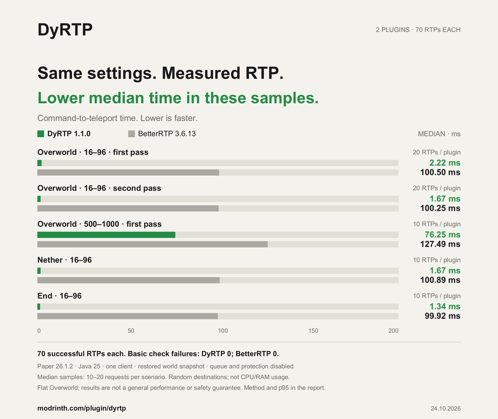

# DyRTP — Random Teleportation Made Simple

**Find new places. Choose your worlds. Keep exploring.**

DyRTP is a command-based random teleport plugin for survival, SMP and economy servers. Help players find new places, choose where they can travel and configure each world without a GUI.

DyRTP combines configurable world profiles, destination safety checks, optional protection hooks and economy support with a familiar command-based workflow. **Version 1.1.0** adds biome choice, cooldowns, prices and distances per rank, PlaceholderAPI placeholders, German, Spanish and Russian messages, MiniMessage formatting and a developer API, while preserving existing settings, aliases and player preferences.

---

## New in 1.1.0

**Choose a biome.** `/rtp biome <biome>` finds a safe spot in the chosen biome, with TAB suggestions. Server owners can limit the choice with `biome-selection.biomes` or turn it off; blacklisted biomes such as oceans can never be chosen.

**Ranks.** `dyrtp.cooldown.<seconds>` and `dyrtp.price.<amount>` give a group its own cooldown or price (the lowest wins), and `dyrtp.radius.<blocks>` its own farthest distance (the highest wins). `dyrtp.cooldown.0` removes the wait.

**Placeholders.** With PlaceholderAPI: `%dyrtp_cooldown%`, `%dyrtp_cooldown_formatted%`, `%dyrtp_ready%`, `%dyrtp_price%`, `%dyrtp_price_formatted%` and `%dyrtp_world%`.

**More languages and MiniMessage.** German, Spanish and Russian join English and Turkish. Messages accept `&` colour codes everywhere and, on Paper and Purpur, MiniMessage tags such as `<gradient:#55ff55:#55ffff>`.

**First join and death.** First-join and death RTP can send players to a chosen world with `first-join-rtp.world` and `death-rtp.world`. New installations read the vanilla `/worldborder` by default.

**For developers.** `DyRTPAPI` reports cooldown, price and destination world and can start an RTP. Anonymous [bStats](https://bstats.org/plugin/bukkit/DyRTP/34913) statistics can be turned off with `metrics.enabled: false`.

## Changes in 1.0.1

**Keep the destination ready.** A bounded plugin chunk ticket retains the selected destination throughout warmup. Tickets are shared safely between requests and released after completion, cancellation, reload or shutdown; terrain and protection are still checked before teleport.

**Stay free without a provider.** Missing Vault or a registered economy provider keeps RTP free, including for ordinary players with older paid settings. Positive prices and enabling payments are rejected until a provider is detected. Provider transaction errors still stop paid requests safely.

**Use shorter commands.** `/dyr` is the player shortcut for `/dyrtp`; `/dyra` opens the existing admin branch with the same permissions and TAB suggestions. Turkish help/TAB use `oto`, with `Oto` as the language label; `otomatik` remains accepted. Help no longer includes a row describing the help command itself.

## Choose your server build

| Server | JAR |
| --- | --- |
| Bukkit, Spigot, Paper, Purpur | `DyRTP-1.1.0.jar` |

Install **one** JAR per server. Stop the server and back up the complete DyRTP folder before replacing an older JAR. Existing world profiles, player preferences and custom translations are retained.

Java 17 bytecode; use the runtime required by your server. Minecraft 1.20.x–26.x is the release listing; the 1.1.0 live checks used Purpur 1.20.4 / Java 21 and Spigot 26.3 / Java 25. Optional integrations must support your selected server too. Historical 1.0.0 downloads retain their original filenames.

[Downloads](https://github.com/DyPlugin/DyRTP/releases/tag/1.1.0) · [Compatibility notes](https://github.com/DyPlugin/DyRTP/blob/main/docs/verification.md)

## Why DyRTP?

**Your worlds, your rules.** Choose a radius, center, shape and allowed biomes for each world. Add a warmup, cooldown or world redirect to fit your server.

**Safety you can configure.** Ground, liquids, height and headroom checks help reject unsafe destinations. Optional protection hooks keep players out of protected areas.

**Automatic language.** English, Turkish, German, Spanish and Russian messages and help follow the effective language. Players can save a preference, and administrators can choose one language for everyone.

**Works with your server.** DyClaim and other supported protection adapters are optional. Add Vault and an economy provider for paid RTP, or use core teleportation without them.

---

## A measured look at teleport time



Measured with DyRTP 1.1.0 on Paper 26.1.2 with one non-OP client: DyRTP had the lower observed median in all five matched-setting samples. Each plugin completed 70 requests. These are command-to-teleport durations, not CPU/RAM measurements, and do not establish a universal speed or safety advantage. Protection and economy were disabled for the timing comparison.

[Method, results and limitations](docs/betterrtp-comparison.md)

## Commands

| Command | Purpose |
|---|---|
| `/dyrtp` or `/dyr` | Search for a safe random destination |
| `/dyrtp help` | Show commands available to you |
| `/dyrtp biome <biome>` | Teleport to a random place in a chosen biome |
| `/dyrtp language <auto/en/tr/de/es/ru>` | Save your language preference |
| `/dyrtp confirm` | Confirm your current paid RTP request |
| `/dyrtp cancel` | Reject your pending confirmation |
| `/dyrtp admin help` or `/dyra` | Show administration commands |
| `/dyrtp admin force <player>` | Force RTP for an exact online player name |
| `/dyrtp admin economy <on/off>` | Enable or disable paid RTP |
| `/dyrtp admin price <amount>` | Set a finite, non-negative price |
| `/dyrtp admin cooldown <seconds/off>` | Configure the reuse cooldown |
| `/dyrtp admin delay <seconds/off>` | Configure the teleport warmup |
| `/dyrtp admin radius min <blocks>` | Configure the minimum radius |
| `/dyrtp admin radius max <blocks>` | Configure the maximum radius |
| `/dyrtp admin language <auto/en/tr/de/es/ru>` | Configure the global language |
| `/dyrtp admin reload` | Validate and reload settings and messages |

`/dyr`, `/rtp`, `/randomtp`, `/wild`, `/wildtp`, `/rastgeletp`, `/rastgeleteleport`, `/forcertp` and `/rtpforce` remain accepted. Existing English, Turkish and ASCII spellings remain accepted when typed manually, including `yonetim`. Help and TAB show the effective language, with the administration branch consistently named `admin`. Player names and other data arguments are never translated. Administrative settings and force commands work from the console; self-RTP and personal language changes require a player.

Legacy `/onayla`, `/confirm`, `/reddet` and `/cancel` registrations remain for compatibility. Other plugins can own those unqualified root commands. Use `/dyrtp confirm` or `/dyrtp cancel`; clickable buttons use `/dyrtp:dyrtp` and an expiring single-use request token, preventing an old button from approving a newer request or a DyClaim operation.

`/dyra <operation>` is equivalent to `/dyrtp admin <operation>`. In Turkish, `oto` selects automatic language; the older `otomatik` alias remains accepted.

## Language and permissions

Global `language.default: en`, `tr`, `de`, `es` or `ru` overrides saved preferences and client locale for messages, help and TAB. With `auto`, saved preference takes priority, then client locale when enabled, with English as the fallback. `save-player-choice` controls whether stored choices are used.

| Permission | Bukkit default | Purpose |
|---|---|---|
| `dyrtp.use` | true | Self-RTP and confirmation |
| `dyrtp.admin` | op | Administration, force RTP and update notices |
| `dyrtp.bypass.cooldown` | op | Skip cooldown |
| `dyrtp.bypass.warmup` | op | Skip warmup |
| `dyrtp.bypass.economy` | op | Skip payment |
| `dyrtp.biome` | true | Choose a biome with `/dyrtp biome` |
| `dyrtp.cooldown.<seconds>` | not set | Own cooldown; the lowest wins |
| `dyrtp.price.<amount>` | not set | Own price; the lowest wins |
| `dyrtp.radius.<blocks>` | not set | Own farthest distance; the highest wins |

Permission checks use Bukkit's effective permission result, including explicit denial. Being OP does not provide an additional unconditional bypass. Each bypass permission is checked separately; there is no new protection bypass.

## Safety and operation lifecycle

World profiles retain center, square/circle radius, world-border, Y-range, biome and redirect settings. Normal worlds and the End use the highest motion-blocking surface excluding leaves; the Nether retains its vertical scan for ground and headroom. End void, liquids, waterlogged blocks, configured hazardous blocks, leaf ground and obstructed headroom are rejected. The existing configurable headroom and surface policies remain available.

Searches have configurable attempt, batch, time and server-wide concurrency limits. Defaults are 240 attempts, 32 cheap candidate checks per batch, 30 seconds and 16 concurrent searches. Each search waits for one candidate chunk load before requesting another, avoiding speculative generation. Loaded and rejected candidates still use the batch budget; rejected batches and failed loads continue on a later tick. Destination preloading retains its configured radius. `load-chunks: false` prevents generation of unloaded candidates. Bukkit world access, protection queries and teleport events execute on the server thread; supported async chunk loading only loads chunks. Already-started server chunk work cannot be undone, but late callbacks cannot apply a cancelled request.

A player has one active operation. Quit, death, external teleport/world change, reload and shutdown invalidate the relevant pending operation. Movement/damage cancellation applies during warmup according to the existing settings. Final validation uses fresh terrain and protection state after warmup and after supported teleport-event redirects; it rejects disabled worlds. Teleport failure or cancellation does not start cooldown or emit success. Successful teleport starts cooldown, preserving the original timing. Existing blindness is kept; cleanup only removes an effect matching DyRTP's own effect.

First-join and death RTP remain disabled by default. `first-join-rtp.world` and `death-rtp.world` send players to another world; an empty value keeps the current behaviour. Death RTP respects `skip-if-bed-or-anchor`. Their delay callbacks are invalidated by lifecycle changes. Forced RTP requires the administrator's permission and retains the existing cause policies for cooldown/payment.

## Protection integrations

DyClaim is optional. When enabled in the protection settings and installed, DyRTP calls its existing `getClaimManager().isChunkClaimed(worldName, chunkX, chunkZ)` API without loading chunks. Signed block coordinates use arithmetic chunk conversion. Claimed chunks are excluded even for their owner or trusted players. Claims created after search are checked again before teleport.

DyClaim query/API errors and installed-but-disabled DyClaim stop RTP safely; warnings are rate limited. Explicitly disabling protection or the DyClaim hook retains the existing opt-out policy. `protection.fail-closed` controls errors from other adapters. Other existing reflection adapters remain, but their names in configuration are not proof of compatibility with every third-party version. Validate your installed integration versions separately.

## Economy and confirmation

Player targets use their complete online name, including the Floodgate prefix (for example `/dyrtp admin force .Player_Name`). TAB preserves that prefix. Names are not stripped or guessed; `.Player_Name` and `Player_Name` remain separate targets. RTP, confirmation and saved preferences are bound to the player's UUID.

Paid RTP requires Vault and a registered economy provider. Without either, RTP remains free; positive prices and enabling payments are rejected until a provider is detected. Missing Vault, missing provider and transaction/query failures are logged separately. Invalid prices are rejected. The confirmation binds the player, cause, source/destination world and quoted price, and expires; permissions and settings are checked again. A changed price/world requires a new request.

The debit happens immediately before teleport. With `economy.charge-on-success-only: true`, a failed/cancelled teleport triggers one refund through the captured provider. With `false`, a successful debit can remain charged after a teleport failure. A successful teleport keeps its debit. Failed or uncertain withdrawals/refunds are never blindly retried; logs identify the player where reconciliation is required. Vault cannot guarantee atomic transactions across provider failures.

## Configuration, upgrades and updates

Keep `plugins/DyRTP/` when replacing the JAR. Missing defaults and message keys are added without resetting custom values or translations; the stock blue prefix/title text migrates to green when unchanged. Player preferences retain their YAML format. Malformed config/messages/player data and invalid bounded settings reject reload while preserving running settings. Administrative edits are validated separately before saving. Check the console when a reload/edit is rejected.

The existing Modrinth checker requests versions for the current Minecraft version and server loader every six hours. It selects stable releases, recognizes Beta-to-stable upgrades and links to the selected version. HTTP/parse errors are reported separately from an empty compatible feed. It notifies the console and players with `dyrtp.admin`; it does not install updates.

## Build and verification

Release listing: Minecraft 1.20.x through currently available 26.x releases on Bukkit, Spigot, Paper and Purpur. Compile target: Java 17 and Purpur/Bukkit API 1.20.4. Runtime Java requirements follow your Minecraft server version. The 1.1.0 checks exercised Purpur 1.20.4 build 2176 on Java 21 and Spigot 26.3 on Java 25; the listing is broader than the live matrix and does not establish verified compatibility with every Minecraft, Spigot, Purpur or protection-provider version.

```text
gradle clean build
```

Use Gradle 9.1 with Java 25, or a Gradle/JDK combination supporting the Java 17 source target. The JAR is `build/libs/DyRTP-1.1.0.jar`. JUnit/Mockito tests are test dependencies only. See [verification record](docs/verification.md) for automated versus actual server coverage and limitations, and [changelog](CHANGELOG.md) for changes from the last stable 1.0.0 release.

An isolated [BetterRTP comparison](docs/betterrtp-comparison.md) records common command-to-teleport measurements across five scenarios. Results vary by profile; they do not establish a universal performance or safety advantage.

## License

GNU Lesser General Public License v3.0 only (`LGPL-3.0-only`). See [LICENSE](LICENSE).

## Get started

1. Stop the server and back up the current JAR and complete `plugins/DyRTP/` folder.
2. Install `DyRTP-1.1.0.jar` and start the server to generate any missing defaults.
3. Configure your worlds, safety checks and English/Turkish messages.
4. Run `/dyrtp admin reload` to apply valid settings.

First-join and death RTP remain disabled until configured. Core RTP needs no other plugin; paid RTP requires Vault and an economy provider.

## Source and support

[Documentation](https://github.com/DyPlugin/DyRTP#readme) · [Report an issue](https://github.com/DyPlugin/DyRTP/issues) · [License](https://github.com/DyPlugin/DyRTP/blob/main/LICENSE)

**By Claww / DyPlugin.**
